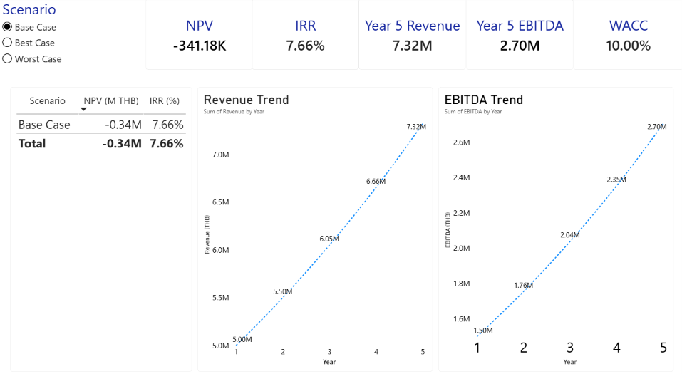

# Strategic Investment Analysis

A financial modeling and business investment evaluation project using Microsoft Excel and Power BI.

## Project Overview

This project evaluates the financial feasibility of a hypothetical investment in a premium healthy-food production and distribution facility. The analysis uses a five-year forecast and three operating scenarios to assess project returns, downside risk, and key investment assumptions.

**Project type:** Illustrative case study  
**Tools:** Microsoft Excel, Power BI  
**Focus:** Financial Modeling, Capital Budgeting, Scenario Analysis, Data Visualization

## Business Problem

Would the proposed investment generate sufficient returns to justify its initial capital expenditure?

The model evaluates project cash flows under different operating assumptions and identifies the conditions required to improve investment viability.

## Methodology

- Built a five-year financial forecast using revenue, cost, tax, depreciation, capital expenditure, and working capital assumptions.
- Calculated Free Cash Flow (FCF) to evaluate the cash generated by the project.
- Used Net Present Value (NPV) and Internal Rate of Return (IRR) to assess investment attractiveness.
- Applied the Weighted Average Cost of Capital (WACC) as the discount rate.
- Compared Base, Best, and Worst Case scenarios.
- Conducted break-even analysis to identify the revenue growth rate and discount rate associated with an NPV of zero.
- Developed an interactive Power BI dashboard to compare financial outcomes across scenarios.

## Key Findings

| Metric | Base Case |
|---|---:|
| Initial Capital Expenditure | THB 5.0 million |
| Year 5 Revenue | THB 7.32 million |
| Year 5 EBITDA | THB 2.70 million |
| Net Present Value (NPV) | -THB 0.34 million |
| Internal Rate of Return (IRR) | 7.66% |
| WACC | 10.00% |
| Revenue Growth Break-even | Approximately 11.78% |

Under the Base Case assumptions, the project has a negative NPV and an IRR below its 10% WACC. Therefore, the investment does not meet the required return threshold under the current assumptions.

The Best and Worst Case scenarios demonstrate how changes in operating assumptions can materially affect project value and investment risk.

## Power BI Dashboard

The interactive dashboard presents:

- Investment evaluation KPIs
- Revenue and EBITDA trends over the forecast period
- Scenario comparisons for NPV and IRR
- Scenario-specific financial assumptions and outcomes

The dashboard is designed to help users understand how changes in assumptions affect investment decisions.

## Skills Demonstrated

- Financial statement forecasting
- Free Cash Flow modeling
- NPV and IRR analysis
- WACC and capital budgeting
- Scenario and sensitivity analysis
- Break-even analysis
- Excel financial modeling
- Power BI dashboard development and data visualization

## Limitations

This is a hypothetical case study created for analytical and portfolio purposes. The assumptions are illustrative and are not based on verified financial information from an actual company. The results should not be interpreted as investment advice.

## Files

- `Strategic_Investment_Analysis.pbix` — Power BI report
- `screenshots/` — Dashboard screenshots
- `README.md` — Project documentation

## Dashboard Preview

